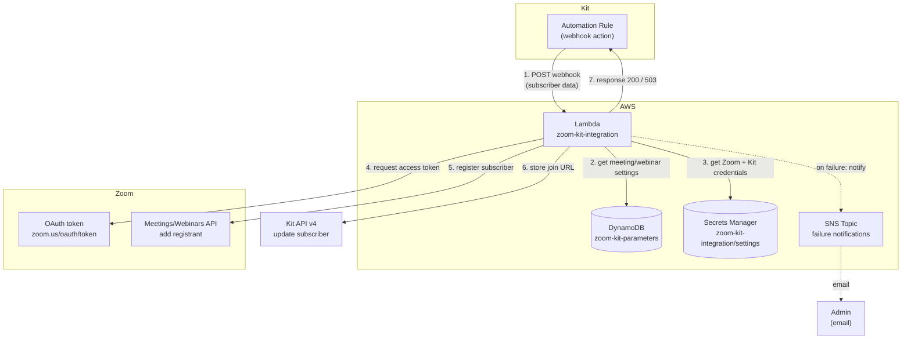

# zki-lambda

AWS Lambda functions that replace the endpoints of the WordPress plugin
`zoom_kit_integration`. They're called by webhooks in Kit automation rules.

| Folder | Replaces | What it does |
|---|---|---|
| [`kit-set-indiv-token-python`](kit-set-indiv-token-python/) | `kit_create_subscriber_token()`, endpoint `/zoom_kit_integration/v2/4UJ8lH9EtZ0D/` | Saves an encrypted per-subscriber token in the Kit custom field `indiv_token`. See its README for setup, the token format and the backfill script |
| [`evergreen-sms-webinar-watch-python`](evergreen-sms-webinar-watch-python/) | nothing (new) | Records evergreen webinar milestones (started, every 10 minutes, reached the pitch) in the DynamoDB event log and Kit, with an allow-list so the page can't apply any other tag. **Live.** Step 1 of the evergreen funnel build |
| *not yet migrated* | `/kit/{token}` and `/kittag/{token}` endpoints | Tag a subscriber from a live webinar's replay page. Only needed if live webinars return, so **low priority**. When migrated, give it its own function. |
| `zoom-kit-add-contact-to-webinar-python` | `add_contact_to_webinar()`, endpoint `/zoom_kit_integration/v2/zar2w` | Registers a Kit subscriber for a Zoom webinar or meeting (Python) |
| `zoom-kit-add-contact-to-webinar` | as above | Node.js version of the same function |

---

## zoom-kit-add-contact-to-webinar

Port of function add_contact_to_webinar, endpoint /zoom_kit_integration/v2/zar2w
from WordPress plugin zoom_kit_integration
to AWS Lambda functions
zoom-kit-add-contact-to-webinar (Node.js)
and
zoom-kit-add-contact-to-webinar-python (Python)

add_contact_to_webinar endpoint is triggered by an automated rule in Kit cms when a subscriber 
fills a form requesting to join a Zoom webinar or meeting.

Example Event JSON from Kit:
{
  "subscriber": {
    "first_name": "Jo Clark",
    "email_address": "jo@email.co.uk",
    "id": "1234567890"
  }
}

1. Request OAuth token from Zoom (client's Zoom account keys from Secrets Manager)
   https://zoom.us/oauth/token
3. Add subscriber to the meeting/webinar in Zoom (webinar ID from DynamoDB parameters table)
   https://api.zoom.us/v2/meetings/<meetingId>/registrants
   OR
   https://api.zoom.us/v2/webinars/<webinarId>/registrants
   Subscriber's individual Zoom meeting join URL is returned.
5. Store join URL in custom field on subscriber's record in Kit (client's Kit account key from Secrets Manager)
   https://api.kit.com/v4/subscribers/<subscriberId>

Any errors are reported via SNS email to client's admin email address and logged to console (for CloudWatch)   
