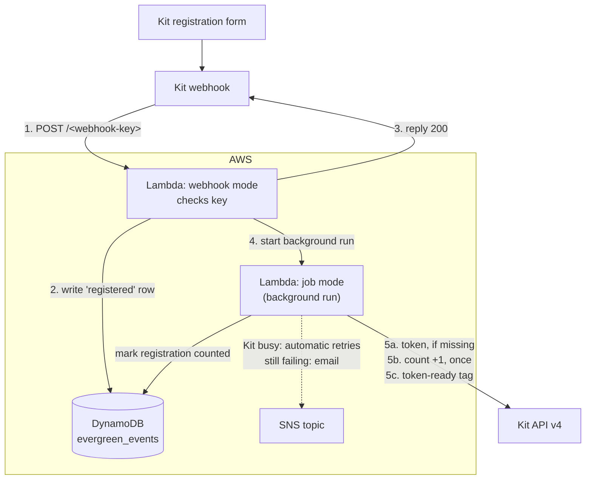

# evergreen-sms-webinar-registration (Python)

Called by a Kit webhook every time someone submits the evergreen webinar
registration form. New for the evergreen funnel (step 2).



## What happens on each registration

1. **Log it.** A `registered` row goes into the event log, and Kit gets its reply
   straight away. Every submission is a new row, re-registrations included.
2. **In the background, in this order:**
   1. **Token:** if the subscriber's token is missing or invalid, a correct one
      is created and saved. A valid existing token is never changed.
   2. **Registration count:** +1, **once per registration**. The job first marks
      that registration's row as counted (`counted_at`). DynamoDB accepts only
      the first mark, so a retry can't count twice. If Kit then fails in a way
      worth retrying, the mark is removed so the retry can count it.
   3. **Token-ready tag:** added last, because it releases the confirmation
      email, so the token is always saved first. If the token couldn't be
      saved, the tag isn't added and admin is emailed.

Not yet included: UTMs on the `registered` row (a later step, once the page
script that passes them to the form exists), and the Kajabi contact (waits on
Spike 2's Kajabi API question).

## Event log rows

The same `evergreen_events` table as `evergreen-sms-webinar-watch`:

| Attribute | Example | |
|---|---|---|
| `subscriber_id` | `1234567890` | partition key |
| `event_at` | `2026-11-06T19:40:12.345Z#a1b2c3` | sort key |
| `event` | `registered` | |
| `source` | `kit_form` | |
| `counted_at` | `2026-11-06T19:40:13.002+00:00` | added once the registration count has been increased |

No email addresses are stored.

## Files

| File | What it is |
|---|---|
| `lambda_function.py` | The function |
| `kit_token.py` | Makes and reads tokens. Identical to the copies in the other two folders: keep them the same |
| `test_lambda_function.py` | Tests (`python3 -m unittest -v`). No AWS or Kit needed. The DynamoDB tests also need `pip install "moto[dynamodb]"`, and are skipped without it |

It needs the same `cryptography-py313-arm64` layer as the other functions.

---

## Setting it up

Work in the same AWS region as your other functions and parameters, and
replace `REGION` and `ACCOUNT` below with your own.

### 1. Parameter Store

Create these in **Systems Manager → Parameter Store**, all **Tier: Standard**:

| Name | Type | Value |
|---|---|---|
| `/zki/evergreen-registration/webhook-key` | **SecureString** | A new random secret (command below) |
| `/zki/evergreen-registration/token-field` | String | Key of the Kit custom field holding the token |
| `/zki/evergreen-registration/registration-count-field` | String | Key of the Kit custom field for the registration count |
| `/zki/evergreen-registration/token-ready-tag-id` | String | ID of the Kit tag that releases the confirmation email |

Make the webhook key with:

```
python3 -c "import secrets; print(secrets.token_urlsafe(32))"
```

This is a separate key from the token function's, so either can be changed
without touching the other. The function also uses the existing
`/zki/kit-api-key` and `/zki/token-secret`. If any parameter is missing, or the
tag ID isn't a number, the function refuses to run and emails you the reason.

### 2. Create the function

Lambda → Create function → **Event Functions** → Author from scratch:
- **Name:** `evergreen-sms-webinar-registration`
- **Runtime:** **Python 3.13**
- **Architecture:** **arm64**

Then:
- **Code:** Upload from → .zip file → a zip of `lambda_function.py` and `kit_token.py` → Save (then Deploy if that button appears).
- **Layer:** Code tab → Layers → Add a layer → Custom layers → `cryptography-py313-arm64`, version 1.
- **General configuration:** timeout **30 sec**, memory 128 MB.
- **Environment variables:** `FAILURE_TOPIC_ARN` = your failure topic ARN.

### 3. Permissions

Configuration → Permissions → role name → Add permissions → Create inline policy → JSON.
Replace `REGION` and `ACCOUNT` (3 places each) and paste in your SNS topic ARN:

```json
{
  "Version": "2012-10-17",
  "Statement": [
    {
      "Effect": "Allow",
      "Action": "ssm:GetParameters",
      "Resource": "arn:aws:ssm:REGION:ACCOUNT:parameter/zki/*"
    },
    {
      "Effect": "Allow",
      "Action": ["dynamodb:PutItem", "dynamodb:UpdateItem"],
      "Resource": "arn:aws:dynamodb:REGION:ACCOUNT:table/evergreen_events"
    },
    {
      "Effect": "Allow",
      "Action": "lambda:InvokeFunction",
      "Resource": "arn:aws:lambda:REGION:ACCOUNT:function:evergreen-sms-webinar-registration"
    },
    {
      "Effect": "Allow",
      "Action": "sns:Publish",
      "Resource": "YOUR_FAILURE_TOPIC_ARN"
    }
  ]
}
```

Name it `evergreen-sms-webinar-registration-access`. `UpdateItem` is only used
to set or remove the `counted_at` mark; the function can't read or delete rows.

### 4. Retries, failure emails, concurrency

- **Asynchronous invocation:** retry attempts **2**, maximum age of event **1 h**.
- **Destinations:** Asynchronous invocation → On failure → SNS topic → your failure topic.
- **Concurrency:** reserve **10**.

### 5. Function URL

Configuration → Function URL → Create: Auth type **NONE**, CORS **off** (only
Kit's servers call it, never a browser). Then in CloudShell (either may say the
permission already exists, which is fine):

```
aws lambda add-permission --function-name evergreen-sms-webinar-registration --statement-id FunctionURLAllowPublicAccess --action lambda:InvokeFunctionUrl --principal "*" --function-url-auth-type NONE
```

```
aws lambda add-permission --function-name evergreen-sms-webinar-registration --statement-id FunctionURLInvokeAllowPublicAccess --action lambda:InvokeFunction --principal "*" --invoked-via-function-url
```

The webhook URL is the Function URL, then the webhook key straight after the
final `/`, with **exactly one** `/` between them and nothing after the key:

```
https://abc123….lambda-url.REGION.on.aws/WEBHOOK-KEY
```

---

## Testing

### A. Postman, before Kit is connected

Pick a test subscriber and note their registration count. POST to the webhook URL, body raw → JSON:

```json
{ "subscriber": { "id": "TEST_SUBSCRIBER_ID" } }
```

Expect `200`. Within a few seconds:
- a `registered` row for them in `evergreen_events`, with `counted_at` set,
- their registration count up by 1,
- the token-ready tag added,
- their token unchanged if they already had one.

Send it again: a **second** row, and the count up by 1 again. Then send it to
the URL with one character of the key changed: `403`, and no new row.

### B. Connect the form

Create the webhook through Kit's API, in Postman:

- **POST** `https://api.kit.com/v4/webhooks`
- **Headers:** `X-Kit-Api-Key: YOUR_KIT_API_KEY`, `Content-Type: application/json`
- **Body:**

```json
{
  "target_url": "WEBHOOK URL FROM STEP 5",
  "event": { "name": "subscriber.form_subscribe", "form_id": FORM_ID }
}
```

`FORM_ID` is the number in the form's address in Kit's editor, without quotes.
**Check `target_url` in Kit's reply character by character**: a stray character
there is what broke the token webhook.

### C. Make every submission reach Lambda: form re-entry rules

**Kit's form webhook only fires the first time a subscriber joins a form.**
A second submission by someone already on the form sends nothing. (Found in
Spike 2, 7 Nov 2026.) Kit's rules can't call webhooks, so the fix is to take
each person back off the form straight after they submit; their next
submission then counts as a first join again.

In Kit, create a temporary tag (e.g. `form_reentry`) and two rules:

| Rule | Trigger | Actions |
|---|---|---|
| 1 | Subscribes to *the registration form* | Add tag `form_reentry` |
| 2 | Tag `form_reentry` added | Unsubscribe from *the registration form*; remove tag `form_reentry` |

"Unsubscribe from a form" only removes them from that form. They stay active
on your list (checked in Spike 2).

**Side effect:** Kit's subscriber count will be correct but the repeat subscriptions
are counted as unique visitors. This reduces the reported conversion rate for the form, 
so don't rely on Kit's form statistics for this funnel. Registrations
come from the `registered` rows and the registration count field instead.

**Automations:** don't start the registration automation on the form, because
the person is removed from it a moment later. Start it on the token-ready tag
being **added** (this function adds it on every registration), and make the
automation's first step remove that tag again, so the next registration
starts a fresh run.

### D. Test re-submissions

Use a **brand-new** email address (anyone who joined the form before the rules
existed is still on it):

1. Submit the form, and wait a minute. In Kit they should be **active**, **not**
   on the form, without the `form_reentry` tag, and with the token-ready tag.
2. Submit again with the same address, and once more after that.

Expect **three** `registered` rows for them and a registration count of **3**.

The existing new-subscriber webhook to `kit-set-indiv-token` will also run for
brand-new subscribers. That's harmless: both functions make the identical token.
