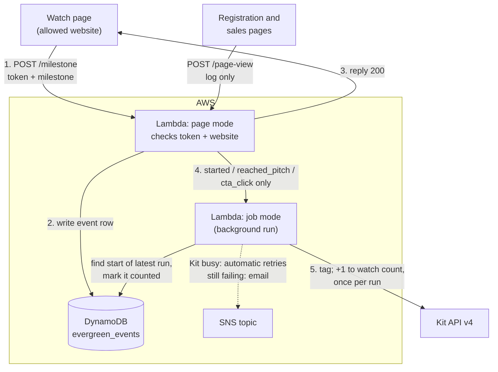

# evergreen-sms-webinar-watch (Python)

Records how far each viewer gets through the evergreen SMS webinar. The watch
page calls it at each milestone. Every milestone is written to the DynamoDB
event log, and the important ones are also recorded in Kit.

It also counts visits to the registration page and the sales page
([Page views](#page-views) below). Those only go to the event log, never to Kit.

New for the evergreen funnel. The page can't choose which tag to apply, so it
can never apply a purchase tag or anything else. (The WordPress plugin's `/kit/`
and `/kittag/` replay endpoints are separate and not yet migrated; see the main README.)



## Milestones

| Milestone | When the page sends it | Kit | Event log |
|---|---|---|---|
| `started` | 30 seconds actually played, so auto-play alone doesn't count | tag `started-tag-id` | ✅ |
| `progress` | the video **plays across** 10:00, 20:00, 30:00… (not when dragged past): `minute` 10, 20, 30… | nothing | ✅ with the minute |
| `reached_pitch` | the position reaches the pitch, however they got there | **only if they watched properly** (below): tag `watched-tag-id`, then add 1 to `watch-count-field`, **once per run** | ✅ with `qualified` |
| `cta_click` | the buy button is clicked | tag `clicked-tag-id` (starts the cart for people who skipped ahead) | ✅ |

The page sends:

```json
{ "token": "<indiv_token>", "milestone": "started" }
{ "token": "<indiv_token>", "milestone": "progress", "minute": 20 }
{ "token": "<indiv_token>", "milestone": "reached_pitch" }
{ "token": "<indiv_token>", "milestone": "cta_click" }
```

The page itself is in [`watch-page/`](watch-page/), with its own README.

The replies are:
- `200`: recorded.
- `400`: unknown milestone, or a minute that isn't 10, 20, 30… up to 240.
- `403`: invalid token, or a call from another website.
- `503`: temporary problem. Details are emailed to admin.

## Page views

The registration page and sales page each have a tiny block (in
[`page-views/`](page-views/), with its own README) that calls `POST /page-view`
once per page load:

```json
{ "page": "registration", "utm_source": "meta", "utm_campaign": "..." }
{ "page": "sales", "token": "<indiv_token>", "utm_source": "email" }
```

| Page | Row logged | Under `subscriber_id` | Extra attributes |
|---|---|---|---|
| `registration` | `registration_page_view` | `registration_page` (visitors haven't registered yet) | UTMs |
| `sales`, good token | `sales_page_visit` | the subscriber | `token_status` = `valid`, UTMs |
| `sales`, no token | `sales_page_visit` | `sales_page` | `token_status` = `missing`, UTMs |
| `sales`, bad token | `sales_page_visit` | `sales_page` | `token_status` = `invalid`, UTMs |

- **UTMs:** `utm_source`, `utm_medium`, `utm_campaign` and `utm_content` from
  the page's own address. Each is kept if it's printable text of up to 100
  characters, and left out otherwise. This gives registration page conversion
  **by source** once registrations carry their UTMs too.
- **Every load counts.** There's no visitor ID or cookie, so the log's
  registration page conversion is the low estimate (GA4's is the high one).
- **Sales visits without a usable token still count**, so a cart email link
  that's missing its token shows up as `missing` instead of disappearing. A bad
  token isn't emailed to admin: an old link is expected now and then.
- **No token is needed for the registration page**, so anyone could call it
  directly and inflate the view count. The website check stops other sites'
  pages; the worst case is a wrong metric, never a wrong tag (accepted 9 Nov).
- Replies: `200` logged; `400` unknown page or bad body; `403` another website;
  `503` the log couldn't be written (admin is emailed).

A blank or non-numeric watch count counts as 0. The tag IDs, field name and
allowed website all come from Parameter Store (step 2 below), so none of them
appear in the code or this guide.

## Watched properly ("qualified")

The watch page only sends a `progress` mark when the video actually plays
across it, not when someone drags past it. When `reached_pitch` arrives, the
background job counts the **distinct** `progress` minutes logged since the start
of the subscriber's **current run**, from any visit and any device.

- The marks required are every 10-minute mark at or before `pitch-second`
  (pitch at 72:09 → 10, 20 … 70: seven marks).
- Up to `allowed-missing-marks` of them may be missing (e.g. 1: six of seven
  is enough), so someone can skip a stretch they've seen before.
- The `reached_pitch` row is marked `qualified` true or false, with
  `missing_marks` listing any that were missing.
- **Qualified:** "watched" tag, watch count (once per run), and the cart starts.
- **Not qualified:** no tag and no count. The page still shows the buy button,
  and clicking it (`cta_click`) starts the cart through the "clicked buy" tag.
- **No run on record:** can't qualify; logged as not qualified, and admin is emailed.

Someone who drags to the pitch, then later goes back and watches the missing
stretches, qualifies on their next `reached_pitch`.

## The watch count: once per run

A **run** is one watch-and-purchase window: the watch window, then the cart
window that opens on reaching the pitch. A run starts with a registration made
while no window was open; `evergreen-sms-webinar-registration` marks that
`registered` row `new_run = true`. Re-registering while a window is open
doesn't start a new run.

The watch count means "how many runs they watched to the pitch", e.g. before
buying. It can never exceed the registration count, which counts runs started.

- **Every `reached_pitch` is logged**, re-watches included, so returning viewers
  stay visible in the event log. The tag is added every time too (harmless).
- **The count goes up once per run.** The background job finds the latest
  `registered` row with `new_run = true` and marks it `pitch_counted_at`.
  DynamoDB accepts only the first mark, so a re-watch during the open cart, a
  second browser tab or a retried job can't count twice. Only the call that
  made the mark adds 1.
- **If Kit is busy** when saving the count, the mark is removed again, so
  Lambda's automatic retry can count it.
- **Only qualified pitches count** (see above).

## The event log: table `evergreen_events`

| Attribute | Example | |
|---|---|---|
| `subscriber_id` | `1234567890` | partition key |
| `event_at` | `2026-11-06T14:12:03.123Z#a1b2c3` | sort key: UTC time, plus a random suffix so two events in the same millisecond don't collide |
| `subscriber_id` (page views) | `registration_page`, `sales_page` | anonymous page views (see [Page views](#page-views)) |
| `event` | `started`, `progress`, `reached_pitch`, `cta_click`, `registration_page_view`, `sales_page_visit` | |
| `minute` | `20` | `progress` only |
| `qualified` | `true` | `reached_pitch` only: whether they watched properly |
| `missing_marks` | `[70]` | `reached_pitch` only: the required marks they hadn't played through |
| `source` | `watch_page`, `registration_page`, `sales_page` | |
| `utm_source`, `utm_medium`, `utm_campaign`, `utm_content` | `meta` | page views only, when the address had them |
| `token_status` | `valid`, `missing`, `invalid` | `sales_page_visit` only |
| `pitch_counted_at` | `2026-11-07T10:20:01+00:00` | on `registered` rows only: set when that registration's watch has been counted |

The index `by_event` (partition `event`, sort `event_at`) answers "all `started` events between two dates". Rows
contain Kit subscriber IDs only, never email addresses. Registrations come
from `evergreen-sms-webinar-registration`; later steps add purchases to the same table.

**Sales page visitors:** count distinct `subscriber_id`s over `sales_page_visit`
rows with `token_status` = `valid`. The anonymous `sales_page` rows can't be
matched to a person or a run; watch their number for broken links.

**Drop-off curve:** count *distinct* `subscriber_id`s per `minute` over the
`progress` rows. Someone who re-watches logs the same minutes again.

## Files

| File | What it is |
|---|---|
| `lambda_function.py` | The function |
| `kit_token.py` | Reads tokens. Identical to the copy in `kit-set-indiv-token-python`: keep them the same |
| `test_lambda_function.py` | Tests (`python3 -m unittest -v`). No AWS or Kit needed. The event log tests also need `pip install "moto[dynamodb]"`, and are skipped without it |
| `watch-page/watch-page.html` | The watch page block: video, tracking and buy button. Paste into a Kajabi Custom Code block |
| `watch-page/README.md` | How the page works, its settings, and how to test it in a browser |
| `page-views/registration-page.js` | Registration page block: page view counter, UTMs into the Kit form, email hand-off. Paste into the page's Custom Javascript |
| `page-views/sales-page.js` | Sales page visit counter. Paste into the page's Custom Javascript |
| `page-views/README.md` | How to add the blocks and test them |

It needs the same `cryptography-py313-arm64` layer as `kit-set-indiv-token`.

---

## Setting it up

Work in the same AWS region as your other functions and parameters throughout.
Below, replace `REGION` with it, e.g. `eu-west-2`.

### 1. Check the concurrency quota

Search for **Service Quotas** → **AWS services** → **AWS Lambda** → **Concurrent executions**.
Note the **Applied account-level quota value**. 1,000 is the usual default, and anything from 100 up is fine.
You've reserved 10 for `kit-set-indiv-token` and will reserve 10 here, and AWS always keeps at least 100 unreserved.

### 2. Add this function's settings to Parameter Store

Nothing specific to the business is in the code. Create these four parameters
in **Systems Manager → Parameter Store**, each with **Tier: Standard** and
**Type: String** (they aren't secrets):

| Name | Value |
|---|---|
| `/zki/evergreen-watch/allowed-origin` | The watch page's website, e.g. `https://www.example.com` (https, no trailing path) |
| `/zki/evergreen-watch/started-tag-id` | ID of the Kit tag for "started watching" |
| `/zki/evergreen-watch/watched-tag-id` | ID of the Kit tag for "reached the pitch" |
| `/zki/evergreen-watch/watch-count-field` | Key of the Kit custom field holding the lifetime watch count |
| `/zki/evergreen-watch/clicked-tag-id` | ID of the Kit tag for "clicked the buy button" |
| `/zki/evergreen-watch/pitch-second` | When the pitch starts, in seconds (e.g. 4329 for 72:09). **Must match `T_PITCH` in the watch page**: change both together |
| `/zki/evergreen-watch/allowed-missing-marks` | How many 10-minute marks before the pitch may be missing, e.g. `1` |

To find a tag's ID in Kit, open the tag: the ID is the number at the end of the
page address. A custom field's key is shown in Kit's custom field settings.

The function also uses the existing `/zki/kit-api-key` and `/zki/token-secret`.
If any of these is missing, or a tag ID isn't a number, the function refuses to
run and emails you the reason.

To change a tag later, edit the parameter. The function reads its settings
once and keeps them, so then make any small change to the function (e.g.
set the timeout to 31 seconds and save) to make it pick up the new value.

### 3. Create the DynamoDB table

Go to **DynamoDB** → **Tables** → **Create table**:
- **Table name:** `evergreen_events`
- **Partition key:** `subscriber_id` (String)
- **Sort key:** `event_at` (String)
- **Table settings:** Customize settings → **Capacity mode: On-demand**. Leave everything else as default.

Click **Create table** and wait until its status is **Active**. Then add the index:
open the table → **Indexes** → **Create index**:
- **Partition key:** `event` (String)
- **Sort key:** `event_at` (String)
- **Index name:** `by_event`
- **Attribute projections:** All

### 4. Create the function

Go to Lambda → Create function → **Event Functions** → Author from scratch:
- **Name:** `evergreen-sms-webinar-watch`
- **Runtime:** **Python 3.13**
- **Architecture:** **arm64**

Then:
- **Code:** Upload from → .zip file → a zip of `lambda_function.py` and `kit_token.py` → Save (then Deploy if that button appears).
- **Layer:** Code tab → Layers → Add a layer → Custom layers → `cryptography-py313-arm64`, version 1.
- **General configuration:** set the timeout to **30 sec** and leave memory at 128 MB.
- **Environment variables:** `FAILURE_TOPIC_ARN` = your failure topic ARN.
  The other optional settings are listed at the top of `lambda_function.py`.

### 5. Permissions

Configuration → Permissions → role name → Add permissions → Create inline policy → JSON.
Replace `REGION` and `ACCOUNT` (3 places each) with your region and 12-digit account number, and paste in your SNS topic ARN:

```json
{
  "Version": "2012-10-17",
  "Statement": [
    {
      "Effect": "Allow",
      "Action": "ssm:GetParameters",
      "Resource": "arn:aws:ssm:REGION:ACCOUNT:parameter/zki/*"
    },
    {
      "Effect": "Allow",
      "Action": ["dynamodb:PutItem", "dynamodb:Query", "dynamodb:UpdateItem"],
      "Resource": "arn:aws:dynamodb:REGION:ACCOUNT:table/evergreen_events"
    },
    {
      "Effect": "Allow",
      "Action": "lambda:InvokeFunction",
      "Resource": "arn:aws:lambda:REGION:ACCOUNT:function:evergreen-sms-webinar-watch"
    },
    {
      "Effect": "Allow",
      "Action": "sns:Publish",
      "Resource": "YOUR_FAILURE_TOPIC_ARN"
    }
  ]
}
```

Name the policy `evergreen-sms-webinar-watch-access`.

The function adds rows, reads one subscriber's history (`Query`) to find their latest registration, and sets or removes the `pitch_counted_at` mark (`UpdateItem`). It can't delete rows.

### 6. Retries, failure emails, concurrency

- **Asynchronous invocation:** retry attempts **2**, maximum age of event **1 h**.
- **Destinations:** Asynchronous invocation → On failure → SNS topic → your failure topic.
- **Concurrency:** reserve **10**. Each call takes a fraction of a second, so 10 handles around 100 calls a second.

### 7. Function URL with CORS

Configuration → Function URL → Create:
- **Auth type:** NONE
- **Configure cross-origin resource sharing (CORS):** ✅ ticked
  - **Allow origin:** your website, exactly the same value as `allowed-origin`, with nothing else in the list
  - **Allow headers:** `content-type`
  - **Allow methods:** `POST`
  - **Max age:** `86400`
  - **Allow credentials:** off

Then, in **CloudShell**:

```
aws lambda add-permission --function-name evergreen-sms-webinar-watch --statement-id FunctionURLAllowPublicAccess --action lambda:InvokeFunctionUrl --principal "*" --function-url-auth-type NONE
```

```
aws lambda add-permission --function-name evergreen-sms-webinar-watch --statement-id FunctionURLInvokeAllowPublicAccess --action lambda:InvokeFunction --principal "*" --invoked-via-function-url
```

The watch page's endpoint is the Function URL followed by `milestone`, e.g.
`https://abc123….lambda-url.REGION.on.aws/milestone`. The registration and sales
pages use the same Function URL followed by `page-view`. All three pages must be
on the `allowed-origin` website.

---

## Test calls

Use a test subscriber whose latest registration **started a run** (a
`registered` row with `new_run` true; register them again with no window tags
if not), and their **current** `indiv_token` from Kit. Before you start, remove the
"started" and "reached the pitch" tags from them and note their watch count.

In Postman, POST to `…on.aws/milestone` with body type raw → JSON. With the
pitch at 72:09 and one missing mark allowed:

| # | Body | Expect |
|---|---|---|
| 1 | `{"token": "TOKEN", "milestone": "started"}` | `200`. Within seconds, the subscriber has the "started" tag |
| 2 | `{"token": "TOKEN", "milestone": "progress", "minute": 10}` | `200`. Nothing changes in Kit |
| 3 | `{"token": "TOKEN", "milestone": "reached_pitch"}` | `200`. **Not qualified** (only one mark): the row shows `qualified` false; no tag, no count |
| 4 | `{"token": "TOKEN", "milestone": "cta_click"}` | `200`. They have the "clicked buy" tag |
| 5 | call 2 again with `minute` 20, 30, 40, 50 and 60, then call 3 | **Qualified** (only 70 missing): "watched" tag, and the watch count goes up by 1 |
| 6 | call 3 again | `200`. Another qualified row, but the watch count does **not** go up (once per run) |
| 7 | `{"token": "TOKEN", "milestone": "progress", "minute": 15}` | `400` |
| 8 | `{"token": "TOKEN", "milestone": "purchased"}` | `400` |
| 9 | `{"token": "TOKEN-WITH-ONE-LETTER-CHANGED", "milestone": "started"}` | `403` |

Then check the log: **DynamoDB** → **Explore items** → `evergreen_events`. The
`reached_pitch` rows show `qualified` and `missing_marks`, there's a `cta_click`
row, there are no rows for calls 7–9, and the `registered` row that started the
run has `pitch_counted_at`.

**Re-registering within the run.** Give the test subscriber the cart-window tag
by hand, submit the registration form, then repeat call 3: the watch count does
**not** go up (the registration was logged with `new_run` false).

**A new run.** Remove both window tags and submit the registration form again.
The new run has no progress marks yet, so call 3 is **not** qualified until you
repeat calls 2 and 5; then the watch count goes up by 1.

**No run.** Repeat call 3 with the token of a subscriber who has never used the
registration form: `200`, not qualified, no tag, no change to their watch
count, and a failure email saying they had no run on record.

**Page views.** POST to `…on.aws/page-view`:

| # | Body | Expect |
|---|---|---|
| 10 | `{"page": "registration", "utm_source": "test"}` | `200`. A `registration_page_view` row under `registration_page`, with `utm_source` |
| 11 | `{"page": "sales", "token": "TOKEN"}` | `200`. A `sales_page_visit` row under the subscriber, `token_status` `valid`. Nothing changes in Kit |
| 12 | `{"page": "sales"}` | `200`. A row under `sales_page`, `token_status` `missing` |
| 13 | `{"page": "sales", "token": "TOKEN-WITH-ONE-LETTER-CHANGED"}` | `200`. A row under `sales_page`, `token_status` `invalid` |
| 14 | `{"page": "watch"}` | `400` |

To test the real pages in a browser, see [`watch-page/README.md`](watch-page/README.md)
and [`page-views/README.md`](page-views/README.md).

**Website check.** Open any other website (e.g. `https://example.com`), open the
browser's developer console (View → Developer → JavaScript Console in Chrome)
and paste:

```js
fetch("https://YOUR-URL.lambda-url.REGION.on.aws/milestone", {method: "POST", headers: {"Content-Type": "application/json"}, body: JSON.stringify({token: "TOKEN", milestone: "progress", minute: 20})}).then(r => console.log(r.status)).catch(e => console.log("Blocked:", e.message))
```

You should see **Blocked** (a CORS error), and no new row in the log.
Running the same line from a page on your allowed website should print `200`.
