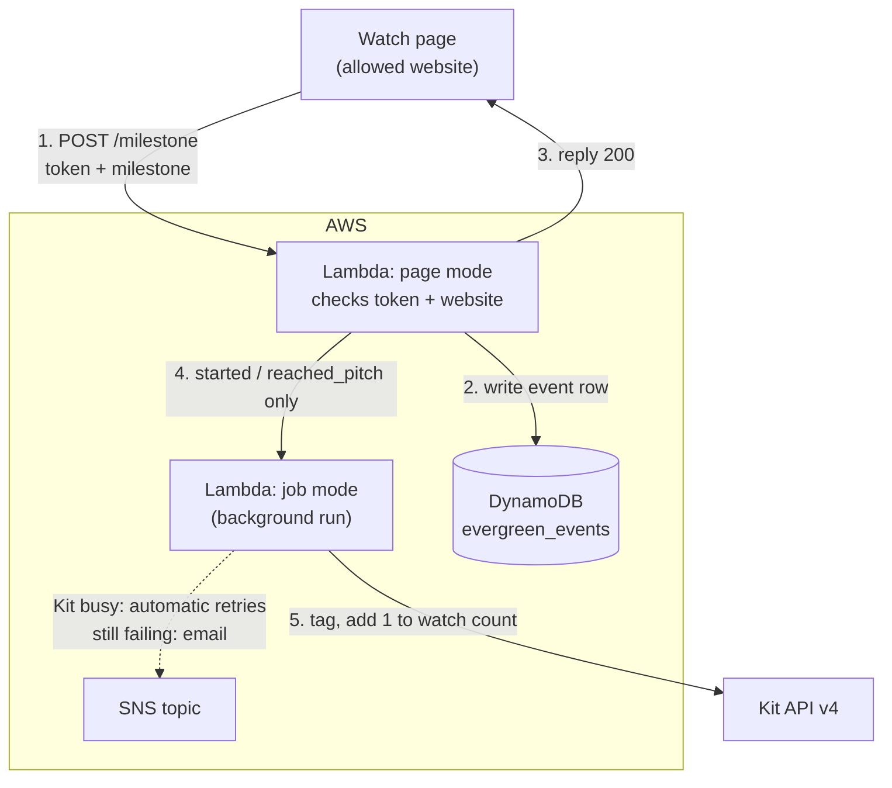

# evergreen-sms-webinar-watch (Python)

Records how far each viewer gets through the evergreen SMS webinar. The watch
page calls it at each milestone. Every milestone is written to the DynamoDB
event log, and the two important ones are also recorded in Kit.

New for the evergreen funnel. The page can't choose which tag to apply, so it
can never apply a purchase tag or anything else. (The WordPress plugin's `/kit/`
and `/kittag/` replay endpoints are separate and not yet migrated; see the main README.)



## Milestones

| Milestone | When the page sends it | Kit | Event log |
|---|---|---|---|
| `started` | 30 seconds of playback, so auto-play alone doesn't count | tag `started-tag-id` | ✅ |
| `progress` | every 10 minutes: `minute` 10, 20, 30… | nothing | ✅ with the minute |
| `reached_pitch` | the pitch timestamp | tag `watched-tag-id`, then add 1 to `watch-count-field` | ✅ |

The page sends:

```json
{ "token": "<indiv_token>", "milestone": "started" }
{ "token": "<indiv_token>", "milestone": "progress", "minute": 20 }
{ "token": "<indiv_token>", "milestone": "reached_pitch" }
```

The replies are:
- `200`: recorded.
- `400`: unknown milestone, or a minute that isn't 10, 20, 30… up to 240.
- `403`: invalid token, or a call from another website.
- `503`: temporary problem. Details are emailed to admin.

A blank or non-numeric watch count counts as 0. The tag IDs, field name and
allowed website all come from Parameter Store (step 2 below), so none of them
appear in the code or this guide.

## The event log: table `evergreen_events`

| Attribute | Example | |
|---|---|---|
| `subscriber_id` | `1234567890` | partition key |
| `event_at` | `2026-11-06T14:12:03.123Z#a1b2c3` | sort key: UTC time, plus a random suffix so two events in the same millisecond don't collide |
| `event` | `started`, `progress`, `reached_pitch` | |
| `minute` | `20` | `progress` only |
| `source` | `watch_page` | |

The index `by_event` (partition `event`, sort `event_at`) answers "all `started` events between two dates". Rows
contain Kit subscriber IDs only, never email addresses. Later steps add more
event types (registrations, sales page visits, purchases) to the same table.

**Drop-off curve:** count *distinct* `subscriber_id`s per `minute` over the
`progress` rows. Someone who re-watches logs the same minutes again.

## Files

| File | What it is |
|---|---|
| `lambda_function.py` | The function |
| `kit_token.py` | Reads tokens. Identical to the copy in `kit-set-indiv-token-python`: keep them the same |
| `test_lambda_function.py` | Tests (`python3 -m unittest -v`). No AWS or Kit needed |

It needs the same `cryptography-py313-arm64` layer as `kit-set-indiv-token`.

---

## Setting it up

Work in the same AWS region as your other functions and parameters throughout.
Below, replace `REGION` with it, e.g. `eu-west-2`.

### 1. Check the concurrency quota

Search for **Service Quotas** → **AWS services** → **AWS Lambda** → **Concurrent executions**.
Note the **Applied account-level quota value**. 1,000 is the usual default, and anything from 100 up is fine.
You've reserved 10 for `kit-set-indiv-token` and will reserve 10 here, and AWS always keeps at least 100 unreserved.

### 2. Add this function's settings to Parameter Store

Nothing specific to the business is in the code. Create these four parameters
in **Systems Manager → Parameter Store**, each with **Tier: Standard** and
**Type: String** (they aren't secrets):

| Name | Value |
|---|---|
| `/zki/evergreen-watch/allowed-origin` | The watch page's website, e.g. `https://www.example.com` (https, no trailing path) |
| `/zki/evergreen-watch/started-tag-id` | ID of the Kit tag for "started watching" |
| `/zki/evergreen-watch/watched-tag-id` | ID of the Kit tag for "reached the pitch" |
| `/zki/evergreen-watch/watch-count-field` | Key of the Kit custom field holding the lifetime watch count |

To find a tag's ID in Kit, open the tag: the ID is the number at the end of the
page address. A custom field's key is shown in Kit's custom field settings.

The function also uses the existing `/zki/kit-api-key` and `/zki/token-secret`.
If any of these is missing, or a tag ID isn't a number, the function refuses to
run and emails you the reason.

To change a tag later, edit the parameter. The function reads its settings
once and keeps them, so then make any small change to the function (e.g.
set the timeout to 31 seconds and save) to make it pick up the new value.

### 3. Create the DynamoDB table

Go to **DynamoDB** → **Tables** → **Create table**:
- **Table name:** `evergreen_events`
- **Partition key:** `subscriber_id` (String)
- **Sort key:** `event_at` (String)
- **Table settings:** Customize settings → **Capacity mode: On-demand**. Leave everything else as default.

Click **Create table** and wait until its status is **Active**. Then add the index:
open the table → **Indexes** → **Create index**:
- **Partition key:** `event` (String)
- **Sort key:** `event_at` (String)
- **Index name:** `by_event`
- **Attribute projections:** All

### 4. Create the function

Go to Lambda → Create function → **Event Functions** → Author from scratch:
- **Name:** `evergreen-sms-webinar-watch`
- **Runtime:** **Python 3.13**
- **Architecture:** **arm64**

Then:
- **Code:** Upload from → .zip file → a zip of `lambda_function.py` and `kit_token.py` → Save (then Deploy if that button appears).
- **Layer:** Code tab → Layers → Add a layer → Custom layers → `cryptography-py313-arm64`, version 1.
- **General configuration:** set the timeout to **30 sec** and leave memory at 128 MB.
- **Environment variables:** `FAILURE_TOPIC_ARN` = your failure topic ARN.
  The other optional settings are listed at the top of `lambda_function.py`.

### 5. Permissions

Configuration → Permissions → role name → Add permissions → Create inline policy → JSON.
Replace `REGION` and `ACCOUNT` (3 places each) with your region and 12-digit account number, and paste in your SNS topic ARN:

```json
{
  "Version": "2012-10-17",
  "Statement": [
    {
      "Effect": "Allow",
      "Action": "ssm:GetParameters",
      "Resource": "arn:aws:ssm:REGION:ACCOUNT:parameter/zki/*"
    },
    {
      "Effect": "Allow",
      "Action": "dynamodb:PutItem",
      "Resource": "arn:aws:dynamodb:REGION:ACCOUNT:table/evergreen_events"
    },
    {
      "Effect": "Allow",
      "Action": "lambda:InvokeFunction",
      "Resource": "arn:aws:lambda:REGION:ACCOUNT:function:evergreen-sms-webinar-watch"
    },
    {
      "Effect": "Allow",
      "Action": "sns:Publish",
      "Resource": "YOUR_FAILURE_TOPIC_ARN"
    }
  ]
}
```

Name the policy `evergreen-sms-webinar-watch-access`.

The function only ever *adds* rows. It has no permission to read, change or delete the log.

### 6. Retries, failure emails, concurrency

- **Asynchronous invocation:** retry attempts **2**, maximum age of event **1 h**.
- **Destinations:** Asynchronous invocation → On failure → SNS topic → your failure topic.
- **Concurrency:** reserve **10**. Each call takes a fraction of a second, so 10 handles around 100 calls a second.

### 7. Function URL with CORS

Configuration → Function URL → Create:
- **Auth type:** NONE
- **Configure cross-origin resource sharing (CORS):** ✅ ticked
  - **Allow origin:** your website, exactly the same value as `allowed-origin`, with nothing else in the list
  - **Allow headers:** `content-type`
  - **Allow methods:** `POST`
  - **Max age:** `86400`
  - **Allow credentials:** off

Then, in **CloudShell**:

```
aws lambda add-permission --function-name evergreen-sms-webinar-watch --statement-id FunctionURLAllowPublicAccess --action lambda:InvokeFunctionUrl --principal "*" --function-url-auth-type NONE
```

```
aws lambda add-permission --function-name evergreen-sms-webinar-watch --statement-id FunctionURLInvokeAllowPublicAccess --action lambda:InvokeFunction --principal "*" --invoked-via-function-url
```

The endpoint is the Function URL followed by `milestone`, e.g.
`https://abc123….lambda-url.REGION.on.aws/milestone`.

---

## Test calls

Use a test subscriber's **current** `indiv_token` from Kit. Before you start,
remove the "started" and "reached the pitch" tags from
them and note their watch count.

In Postman, POST to `…on.aws/milestone` with body type raw → JSON:

| # | Body | Expect |
|---|---|---|
| 1 | `{"token": "TOKEN", "milestone": "started"}` | `200`. Within seconds, the subscriber has the "started" tag |
| 2 | `{"token": "TOKEN", "milestone": "progress", "minute": 10}` | `200`. Nothing changes in Kit |
| 3 | `{"token": "TOKEN", "milestone": "reached_pitch"}` | `200`. They have the "reached the pitch" tag, and the watch count has gone up by 1 |
| 4 | `{"token": "TOKEN", "milestone": "progress", "minute": 15}` | `400` |
| 5 | `{"token": "TOKEN", "milestone": "purchased"}` | `400` |
| 6 | `{"token": "TOKEN-WITH-ONE-LETTER-CHANGED", "milestone": "started"}` | `403` |

Then check the log: **DynamoDB** → **Explore items** → `evergreen_events`. There
should be three rows for the subscriber's ID (`started`, `progress` with minute 10,
`reached_pitch`), and none for calls 4–6.

**Website check.** Open any other website (e.g. `https://example.com`), open the
browser's developer console (View → Developer → JavaScript Console in Chrome)
and paste:

```js
fetch("https://YOUR-URL.lambda-url.REGION.on.aws/milestone", {method: "POST", headers: {"Content-Type": "application/json"}, body: JSON.stringify({token: "TOKEN", milestone: "progress", minute: 20})}).then(r => console.log(r.status)).catch(e => console.log("Blocked:", e.message))
```

You should see **Blocked** (a CORS error), and no new row in the log.
Running the same line from a page on your allowed website should print `200`.

---

## Planned for step 2 (agreed 6 Nov 2026)

These change when the Kit sign-up webhook starts logging `registered` rows:

- **Every event stays in the log**, re-watches included, so returning viewers are visible.
- **The watch count goes up once per registration**, not once per `reached_pitch`.
  It means "how many registrations they actually watched to the pitch before buying".
  On `reached_pitch`, Lambda finds the subscriber's latest `registered` row and
  writes a one-off "counted" marker for it. DynamoDB accepts only the first
  marker, so two tabs at once can't count twice, and only then is the Kit count increased.
- **No registration on record** (e.g. a test subscriber): proposed to log the
  event, not count it, and email admin. To confirm when planning step 2.
- **Extra permission:** `dynamodb:Query` on `evergreen_events`, so the function can
  read one subscriber's history.

Until then, every `reached_pitch` adds 1, which is harmless before launch.

