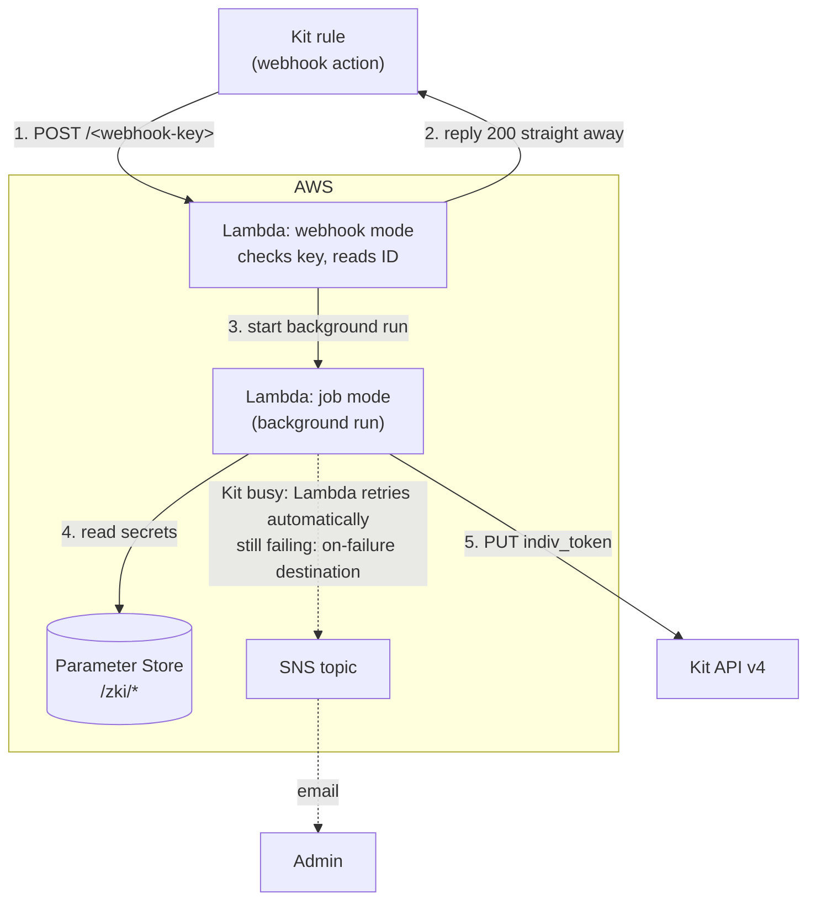

# kit-set-indiv-token (Python)

Port of `kit_create_subscriber_token()`, endpoint `/djapp/v2/4UJ8lH9EtZ0D/`,
from the WordPress plugin `zoom_kit_integration` to an AWS Lambda function.

A Kit automation rule calls this function's webhook URL. The function saves a
signed token in the subscriber's `indiv_token` custom field, ready for links to
the replay page.



## Files

| File | What it is |
|---|---|
| `lambda_function.py` | The Lambda function |
| `kit_token.py` | Makes and checks tokens. The replay tagging function will reuse this file unchanged |
| `backfill_tokens.py` | Run on your own computer to give every subscriber a correct token |
| `test_lambda_function.py` | Tests (`python3 -m unittest -v`). No AWS or Kit needed |

The one third-party library, `cryptography`, goes in a Lambda layer
(`cryptography-layer-py313-arm64.zip`), so the function code itself stays as two
small files you can edit in the console. Lambda already includes `boto3`.

## Token format

`dL4g-N44DppxgvbS4JF1OEhhF0qIGs69Y3o`: the Kit subscriber ID, encrypted with
AES-SIV using `/zki/token-secret`. These tokens are 35 characters for a 10-digit ID
and are URL-safe.

- **The ID can't be read** from the token without the key.
- **Tokens can't be forged or altered.** Any change makes the token invalid.
- **The same subscriber always gets the same token,** so re-runs don't churn anyone's link.

These replace the old AES-128-CBC tokens; `backfill_tokens.py` overwrites them.
If the key ever leaks, put a new one in Parameter Store and run the backfill
again, and every old token stops working.

---

## Deploying

Replace `REGION` and `ACCOUNT` with your own, e.g. `eu-west-2` and your 12-digit account ID.

### 1. Parameter Store

Systems Manager → Parameter Store → Create parameter. Create three, each with
**Tier: Standard**, **Type: SecureString** and the default KMS key (`alias/aws/ssm`):

| Name | Value |
|---|---|
| `/zki/kit-api-key` | Your Kit v4 API key |
| `/zki/token-secret` | A new 64-byte encryption key (command below) |
| `/zki/webhook-key` | A new random secret (command below) |

Make the **token-secret** with this command. It must be exactly this form, or the
function will refuse it:

```
python3 -c "import secrets,base64; print(base64.urlsafe_b64encode(secrets.token_bytes(64)).decode())"
```

Make the **webhook-key** with:

```
python3 -c "import secrets; print(secrets.token_urlsafe(32))"
```

Standard-tier parameters are free.

### 2. Create the function

Lambda → Create function → Author from scratch:

- **Name:** `kit-set-indiv-token`
- **Runtime:** **Python 3.13**
- **Architecture:** **arm64**

Both must be exactly these, because the layer below is built for them. If you
ever change either one, the layer has to be rebuilt to match.

Then add the layer:

1. Lambda → **Layers** → Create layer.
2. Name it `cryptography-py313-arm64` and upload `cryptography-layer-py313-arm64.zip`.
3. Set compatible runtime **Python 3.13** and architecture **arm64**.
4. Back on the function, go to Code → Layers → Add a layer → Custom layers → choose it.

To rebuild the layer later (e.g. for a security update to `cryptography`):

```
pip install --platform manylinux2014_aarch64 --implementation cp --python-version 3.13 \
    --only-binary=:all: --target layer/python cryptography
cd layer && zip -r ../cryptography-layer-py313-arm64.zip python
```

Then:

- **Code:** upload a zip containing `lambda_function.py` and `kit_token.py`, or paste
  both into the console editor as two files.
- **Configuration → General:** timeout **30 seconds**, memory **128 MB**.
- **Configuration → Environment variables:**
  `FAILURE_TOPIC_ARN` = your existing failure SNS topic ARN.
  `PARAM_PREFIX` defaults to `/zki/` and `KIT_TOKEN_FIELD` defaults to `indiv_token`; you only
  need to set these if you want different values.

### 3. Permissions

Configuration → Permissions → click the role name → Add permissions → Create inline policy → JSON:

```json
{
  "Version": "2012-10-17",
  "Statement": [
    {
      "Effect": "Allow",
      "Action": "ssm:GetParameters",
      "Resource": "arn:aws:ssm:REGION:ACCOUNT:parameter/zki/*"
    },
    {
      "Effect": "Allow",
      "Action": "lambda:InvokeFunction",
      "Resource": "arn:aws:lambda:REGION:ACCOUNT:function:kit-set-indiv-token"
    },
    {
      "Effect": "Allow",
      "Action": "sns:Publish",
      "Resource": "YOUR_FAILURE_TOPIC_ARN"
    }
  ]
}
```

The role already has `AWSLambdaBasicExecutionRole`, which covers CloudWatch logs.
If a test shows a KMS "AccessDenied" error when reading the parameters, also add
`kms:Decrypt` on the `aws/ssm` key.

### 4. Retries and failure emails

Configuration → **Asynchronous invocation** → Edit:
- Retry attempts: **2**
- Maximum age of event: **1 hour**

Configuration → **Destinations** → Add destination:
- Source: Asynchronous invocation
- Condition: **On failure**
- Destination type: SNS topic → your failure topic

A job that still fails after both retries is then emailed to you. The email
contains the subscriber ID.

### 5. Cap the cost of misuse

Configuration → Concurrency → Edit → Reserve concurrency: **10**.

That's ample for Kit, since each webhook call takes a fraction of a second. It
also caps what anyone hammering the URL could cost you.

### 6. Function URL

Configuration → Function URL → Create:
- Auth type: **NONE**. The function checks the secret key itself.
- CORS: leave off. Only Kit's servers call this URL, never a browser.

Your webhook URL is the Function URL followed by your webhook key:

```
https://abc123xyz.lambda-url.REGION.on.aws/<value of /zki/webhook-key>
```

### 7. Test with one real subscriber (yourself)

In Postman, POST to the webhook URL with this body:

```json
{ "subscriber": { "id": "YOUR_KIT_SUBSCRIBER_ID" } }
```

You should get `200 {"response": "OK"}` straight away. Within a few seconds,
your `indiv_token` in Kit should show the new `ID.signature` format.
CloudWatch logs should show "Accepted subscriber..." and then "Saved indiv_token...".

Then POST to the URL with the wrong key on the end. You should get `403`.

### 8. Point Kit at it

Edit the Kit rule's webhook action:
1. Replace the old `djapp.derekandjo.com/...` URL with the webhook URL from step 6.
2. Switch the rule back on.

### 9. Catch everyone up

Run this on your Mac. It needs no AWS setup, just Python and two libraries:

```
pip3 install --user boto3 cryptography
```

Then, from this folder:

```
python3 backfill_tokens.py --ask-secrets --limit 3 --apply        # try 3 subscribers first
caffeinate -i python3 backfill_tokens.py --ask-secrets --apply    # then everyone
```

Each time, it asks you to paste `/zki/kit-api-key` and `/zki/token-secret`. Get them
from Parameter Store → the parameter → **Show decrypted value**. Nothing appears on
screen as you paste, and nothing is saved.

Notes:

- `caffeinate -i` keeps your Mac awake while the script runs.
- The script works at about 110 subscribers a minute, under Kit's limit of 120.
  7,000 subscribers take roughly 70 minutes. It prints progress every 100.
- It skips anyone who already has the right token. If it stops or reports
  failures, run the same command again.
- By default it covers **active** subscribers. Add `--status inactive` to do
  unconfirmed ones, or `--status all` for everyone.
- Leave out `--apply` for a dry run that only reports what it would change.

**Use this script, not the Kit rule, for bulk changes.** Firing the rule for
thousands of subscribers at once would hit Kit's rate limit faster than
Lambda's retries can absorb.

### 10. Tidy up

Once this has run smoothly for a week or two, remove the `4UJ8lH9EtZ0D`
endpoint from the WordPress plugin.
